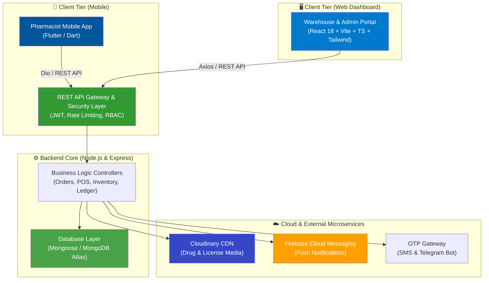
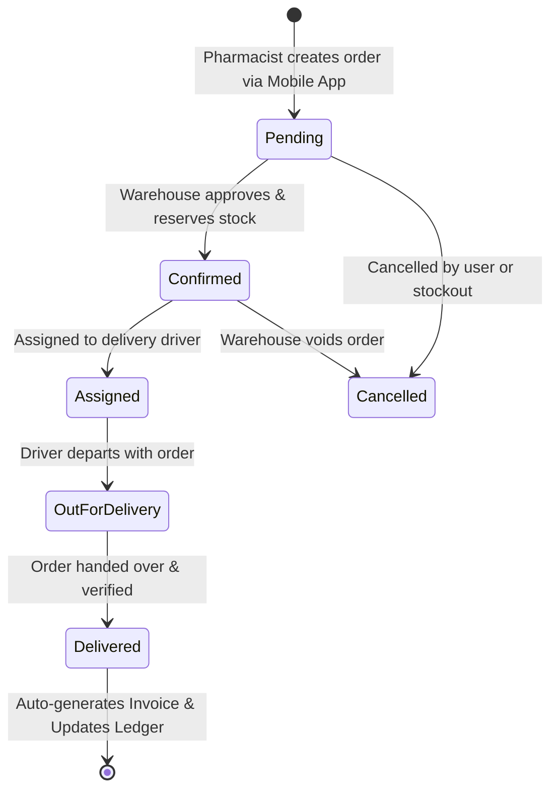
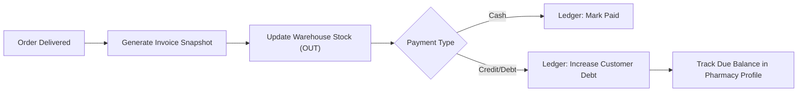

# 🏥 Viatica (فارمجي — Farmaji)
### Enterprise B2B Pharmaceutical Supply Chain & ERP Ecosystem

[](https://nodejs.org/)
[](https://expressjs.com/)
[](https://www.mongodb.com/)
[](https://react.dev/)
[](https://www.typescriptlang.org/)
[](https://flutter.dev/)
[](https://tailwindcss.com/)
[](LICENSE)

---

## 📌 Executive Summary

**Viatica (Farmaji)** is an end-to-end B2B Pharmaceutical ERP and Supply Chain ecosystem engineered to streamline operations between **pharmaceutical warehouses, drug distributors, and community pharmacies**.

It bridges the traditional gap in the pharmaceutical distribution market by unifying real-time inventory tracking, mobile ordering, direct point-of-sale (POS), financial ledgers, returns, supplier purchases, and delivery logistics into a cohesive, high-performance architecture.

---

## 🏗️ System Architecture

The ecosystem consists of three unified tiers communicating via standard REST APIs, secured with JWT and Role-Based Access Control (RBAC):



---

## 🌟 Key Modules & Features

### 1. 🏢 Warehouse & Admin Dashboard (React + TypeScript)
- **Real-Time Inventory Engine:** Drug batch tracking, scientific and trade names, expiry alerts, low-stock warnings, and barcode scanning.
- **Direct Wholesale POS:** Rapid checkout for direct sales with automatic invoice generation and cash/debt handling.
- **Order Lifecycle Management:** Live order queue (`Pending` ➔ `Confirmed` ➔ `Assigned` ➔ `Out for Delivery` ➔ `Delivered`).
- **Financial Ledger & Debt Tracking:** Automatic debit/credit reconciliation, customer credit limits, payment collection receipts, and aging balances.
- **Supplier & Purchase Management:** Manage vendor accounts, bill entries, stock arrivals, and payment schedules.
- **Returns & Credit Notes:** Defective/expired drug return cycles with automatic stock restoration and customer ledger deductions.
- **Advanced Analytics & Audit Logs:** Revenue charts, top-moving items, profit margins, and security audit trails.

### 2. 📱 Pharmacist Mobile Application (Flutter)
- **Interactive Drug Catalog:** Instant search, categorical browsing, real-time stock availability, and tiered pricing.
- **Promotions & Bonus Offers:** Automated calculation of drug bundles, percentage discounts, and free delivery perks.
- **Digital Cart & Checkout:** Seamless order submission directly into the warehouse ERP pipeline.
- **Account & Debt Balance:** Pharmacists can view their outstanding balances, past invoices, and payment receipts.
- **Live Order Tracking:** Push notification updates on delivery statuses through Firebase Cloud Messaging (FCM).
- **Secure Onboarding:** Pharmacist registration verified by pharmacy license photo and authenticated via OTP.

### 3. ⚙️ Central Backend API (Node.js / Express / MongoDB)
- **Scalable RESTful Architecture:** Well-structured MVC/Repository pattern with modular routes and middleware.
- **Multi-Tenant Role-Based Access Control (RBAC):** Strict authorization guards for `Admin`, `Warehouse`, `Pharmacist`, `Driver`, and `Customer`.
- **Atomic Financial Transactions:** Strict consistency when converting orders into legal invoices and ledger entries.
- **Security & Hardening:** Express rate limiting, Helmet headers, CORS policies, JWT token rotation, and password hashing with `bcrypt`.

---

## 🔄 Core Business Workflows

### Order Fulfillment Cycle


### Financial Reconciliation Pipeline


---

## 🗄️ Database Models Overview

The core domain model consists of 15 interconnected schemas:

| Model | Purpose |
| :--- | :--- |
| **`User`** | System actors (`admin`, `warehouse`, `pharmacist`, `driver`, `customer`) |
| **`Drug`** | Master inventory records (trade name, active ingredient, barcode, wholesale/retail prices, expiry) |
| **`Order`** | Mobile orders and direct manual wholesale orders |
| **`Invoice`** | Immutable sales record with warehouse snapshot at issue time |
| **`Ledger`** | Financial transaction records (debits, credits, settlements) |
| **`Return`** | RMA and return logs with automatic inventory restocking |
| **`Offer`** | Promotional campaigns, bonuses, and volume discounts |
| **`Purchase`** | Inbound supplier invoices and raw stock procurement |
| **`Supplier`** | External drug manufacturers and wholesale vendors |
| **`Expense`** | Operational expenses (utilities, logistics, salaries) |
| **`StockMovement`**| Audit log for every single unit increment/decrement |
| **`PharmacistStock`**| Optional lightweight shelf inventory tool for pharmacists |
| **`Notification`** | System alerts and user notifications |
| **`FeedItem`** | Farmaji Pulse community updates and regulatory news |
| **`AuditLog`** | Tamper-evident admin & security action logs |

---

## 💻 Tech Stack

| Domain | Technology | Description |
| :--- | :--- | :--- |
| **Backend Runtime** | [Node.js](https://nodejs.org/) (v18+) | Non-blocking server runtime |
| **Backend Framework** | [Express.js](https://expressjs.com/) | REST API micro-framework |
| **Primary Database** | [MongoDB Atlas](https://www.mongodb.com/) / [Mongoose](https://mongoosejs.com/) | Document-oriented scalable storage |
| **ORM / Migration** | [Prisma](https://www.prisma.io/) / [Knex](https://knexjs.org/) | Data migration and schema validation |
| **Frontend Framework**| [React 18](https://react.dev/) + [Vite](https://vitejs.dev/) | High-performance dashboard build system |
| **Frontend Language** | [TypeScript](https://www.typescriptlang.org/) | Type-safe enterprise code quality |
| **UI & Styling** | [TailwindCSS](https://tailwindcss.com/) + [Lucide Icons](https://lucide.dev/) | Modern utility-first design system |
| **Mobile Framework** | [Flutter](https://flutter.dev/) (Dart 3.x) | Native multiplatform iOS & Android client |
| **State & Routing** | [GoRouter](https://pub.dev/packages/go_router) / Provider | Declarative routing and reactive state |
| **Media Storage** | [Cloudinary](https://cloudinary.com/) | Optimized image uploads and asset CDN |
| **Push Notifications**| [Firebase Cloud Messaging](https://firebase.google.com/) | Real-time mobile push triggers |

---

## 📁 Repository Structure

```text
Viatica-Project/
├── backend/                  # Node.js Express REST API server
│   ├── config/               # Database, Cloudinary, Firebase configs
│   ├── controllers/          # Business logic (Orders, Inventory, Invoices, etc.)
│   ├── middlewares/          # JWT Auth, RBAC, Error Handlers, File Uploads
│   ├── models/               # Mongoose & Prisma schemas (15 models)
│   ├── routes/               # API route definitions
│   ├── services/             # Notification, AI, and background services
│   └── server.js             # Application entry point
│
├── frontend/                 # React 18 + Vite Warehouse & Admin Portal
│   ├── src/
│   │   ├── components/       # Reusable UI widgets & layout elements
│   │   ├── pages/            # Dashboard, POS, Inventory, Orders, Analytics
│   │   ├── services/         # API integration via Axios
│   │   └── types/            # TypeScript data contracts
│   └── package.json
│
├── mobile-app/               # Flutter Pharmacist Android & iOS Application
│   ├── lib/
│   │   ├── screens/          # Catalog, Cart, Order History, Profile
│   │   ├── services/         # Dio HTTP client, FCM handler
│   │   ├── models/           # Dart data models
│   │   └── widgets/          # Custom components, badges, shimmer loaders
│   └── pubspec.yaml
│
├── documentation/            # Architectural specs, walkthroughs, and deployment logs
└── README.md
```

---

## 🚀 Getting Started

### Prerequisites
- **Node.js** (>= 18.x) & **npm** / **yarn**
- **Flutter SDK** (>= 3.x) & **Dart SDK**
- **MongoDB Atlas** account or local MongoDB instance
- **Cloudinary** & **Firebase** service credentials

---

### 1. Backend Setup
```bash
# Navigate to the backend directory
cd backend

# Install dependencies
npm install

# Configure environment variables
cp .env.example .env
# Edit .env with your MongoDB URI, JWT_SECRET, Cloudinary, and Firebase keys

# Start development server
npm run dev
# The API will start on http://localhost:5000
```

### 2. Dashboard Setup (Frontend)
```bash
# Navigate to the dashboard directory
cd ../frontend

# Install dependencies
npm install

# Start Vite development server
npm run dev
# Access the portal at http://localhost:5173
```

### 3. Mobile App Setup (Flutter)
```bash
# Navigate to the mobile application directory
cd ../mobile-app

# Fetch Flutter packages
flutter pub get

# Run on connected device or emulator
flutter run
```

---

## 🔒 Security & Data Integrity

- **Strict RBAC Enforcement:** Every route is safeguarded with role verifications (`verifyToken`, `requireRole(['warehouse', 'admin'])`).
- **Data Protection:** Passwords securely hashed with `bcryptjs` using 12 salt rounds.
- **Snapshot Immutability:** Invoices store historical copies of drug prices and warehouse data to protect past financial audits from subsequent catalog edits.
- **Audit Logging:** Administrative operations and high-value financial actions are logged into `AuditLog` records.

---

## 👨‍💻 Author & Contributions

Developed by **[Alaa Azayoud](https://github.com/alaaazayoud-debug)**  
*Full-Stack Engineer & Mobile Solutions Architect*

For enterprise support, feature requests, or inquiries, please open an issue in this repository or contact directly via GitHub.

---

## 📄 License

This project is licensed under the **MIT License** — see the [LICENSE](LICENSE) file for details.
